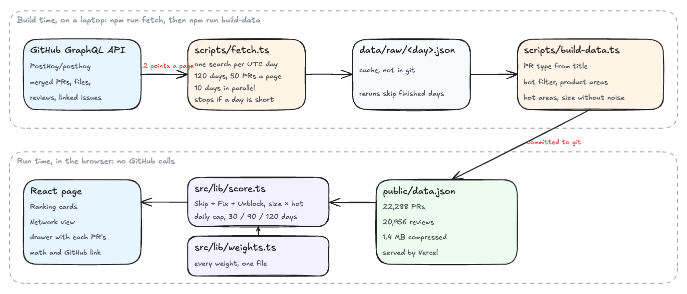

# Who's moving PostHog forward

**Live: https://weave-assignment-posthog.vercel.app**

One page that answers one question for a busy engineering leader. Who are the 5
most impactful engineers in [PostHog/posthog](https://github.com/PostHog/posthog)
right now, and why? Every number on the page links to the PRs behind it.

## How impact is defined

Lines of code and commit counts reward noise. Here, every merged PR and every
review earns points in exactly one of three buckets:

| Bucket | What counts | Points |
| --- | --- | --- |
| **Ship** | Merged PRs that build something | feature 3, perf 2, refactor 1.5, chore or docs 0.5 |
| **Fix** | Merged fix, revert and hotfix PRs | 2, plus 1 if it closes a reported issue |
| **Unblock** | Reviews of other people's PRs | approve 0.5, comment 1, request changes 1.5 |

Each PR's points are then scaled twice:

- **Size**, from 0.5× to 1× on a log scale. One 1,000 line PR is not worth 100
  small ones, and lockfiles, snapshots and generated code don't count.
- **Hot areas**, up to 1.5× for code that many engineers touch, such as `posthog/api`.

Rank is Ship + Fix + Unblock. Ties go to whoever worked in more product areas.

## How the data was gathered

- **Source:** GitHub's GraphQL API, every PR merged into `PostHog/posthog` in the
  last **120 days**. That's 22,288 PRs and 20,956 human reviews.
- **Snapshot:** a script saves the result as `public/data.json`, 1.4 MB compressed.
  The page loads that one file and never calls GitHub.



## How it was analyzed

- **PR type** comes from PostHog's `type(scope): title` naming, for example `fix(flags): …`.
- **Product areas** come from file paths, for example `products/feature_flags`.
- **Hot areas** are the 10% of areas touched by the most distinct engineers.
- **Bots** are removed: dependabot, PostHog's automation accounts and deleted users.
- **Daily cap.** Only a person's best 5 PRs and best 10 reviews per day count.
  No one ships 150 PRs a day by hand, so past that point extra volume shows how
  much was automated, not more impact.
- **Windows.** Scoring runs in the browser, so switching between 30, 90 and 120
  days is instant. 90 is the default.

## How to check any number

- **Ranking view:** top 5 cards, each with a one-line reason, points per bucket
  and their biggest PRs. Ranks 6 to 10 sit on the right.
- **Click a person:** a side panel lists every PR and review behind their score,
  each with its math (`3 × 0.92 × 1.25`) and a GitHub link. Capped work shows at 0.
- **Network view:** the top 12 as a map of who reviews whom. Thicker lines mean
  more reviews between that pair. Hover a person to see the counts.
- **"How the points work" panel:** reads every weight from `src/lib/weights.ts`,
  so the explanation can't drift from the math.

## Problems I hit and how I fixed them

| Problem | Fix |
| --- | --- |
| GitHub search returns at most 1,000 results, and PostHog merges about 200 PRs a day | One GraphQL search per UTC day. The fetch stops if any day comes back short |
| REST would need thousands of calls for files and reviews | GraphQL gets PRs, files, reviews and linked issues in one query, at 2 rate-limit points per 50 PRs (about 900 of the 5,000 per hour) |
| Calling GitHub on page load would be slow and hit rate limits | Build once, ship a static JSON file. Loads in under a second |
| One engineer merged 151 PRs in a single day, and two reviewers left about 400 reviews each, mostly on that person's PRs | The daily cap. Without it, volume alone decided the ranking |
| One-click approvals of dependency bumps inflated review points | Approving a bot's PR without a comment earns 0 |
| Reviews were cut off at 40 per PR | Raised to 100 and re-fetched, which recovered 349 reviews |

## Checked against the red flags

- **Link works and loads fast.** It's public on Vercel with no sign-in, ready in about 0.5 s.
- **Data is complete.** It covers 120 days, and the fetch fails loudly on any missing day.
- **The UI works.** It was tested in a real browser at 1440×760, 1280×720 and
  phone width, in both themes. 94 unit tests cover the scoring.
- **It answers the question.** The top 5 are on screen with a reason for each.
- **No unexplained numbers.** Every score breaks down to linked PRs, and every weight is shown.
- **No bots** in the ranking.

## Limits

- Only merged PRs count, so reviews on unmerged PRs are missing.
- PR type trusts the author's own title.
- Files and reviews past the first 100 in a PR are skipped. That affects 12 PRs.
- GitHub can't tell staff from community contributors. The top ranks are all
  people with months of steady work.
- The daily cap of 5 PRs is a judgment call. The #1 engineer still leads by about 2×.
- Impact outside GitHub isn't visible: design docs, incident calls, mentoring.

## Not done yet: automatic refresh

The live site is a snapshot, dated by the "data as of Oct 23, 2026" label. To
refresh it, someone reruns `npm run fetch` and `npm run build-data`, then pushes.
A scheduled nightly refresh, such as a GitHub Action with a token, was left as a
follow-up. The default Actions token gets 1,000 GraphQL points per hour, which
is too few for a full run of about 900 points plus retries.

## How it was built

- **Plan first.** A short design doc and plan in [`docs/`](docs/), split into 5
  ticket issues (#1 to #5).
- **Two PRs.** One for the data and scoring (#6), and one stacked on it for the
  UI and this README (#7). A one-line CI fix followed in #8.
- **Two reviewers on every PR.** A Claude staff review that scores the PR, and
  Greptile with rules from this project. Every P0 and P1 finding was fixed with a
  test before merging.
- **Repo skills** in `.agents/skills/workflow/` for commit, PR, staff review,
  babysitting a PR and signoff.

## Run it yourself

```bash
npm install
npm run fetch        # about 3 minutes; uses `gh auth token` or GITHUB_TOKEN
npm run build-data   # writes public/data.json
npm run dev          # http://localhost:5173
npm run check        # typecheck, tests and build
```

Built with Vite, React and TypeScript, with no chart library. The scoring code
lives in `src/lib/` as plain functions with tests. The design and the plan are in [`docs/`](docs/).
